<p align="center">
  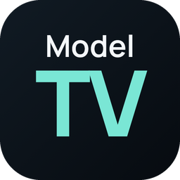
</p>

<h1 align="center">ModelTV</h1>

<p align="center">
  <b>Your playlist, in cinema mode.</b><br>
  The IPTV player built for the remote, on Android TV, Google TV, Fire TV, Android, iPhone, iPad and Apple TV.
</p>

<p align="center">
  <a href="https://play.google.com/store/apps/details?id=app.modeltv.player"></a>
  <a href="https://apps.apple.com/app/id6818954576"></a>
</p>

<p align="center">
  <a href="https://modeltv.app/en/">Website</a> ·
  <a href="https://github.com/B-DAGBERT/ModelTV-Releases/releases/latest/download/ModelTV.apk">Download the APK</a> ·
  <a href="https://modeltv.app/en/tv/">Install on your TV</a> ·
  <a href="https://youtu.be/qLv1TJYQdLA">Video (38 s)</a> ·
  <a href="https://modeltv.app/en/whats-new/">What's new</a> ·
  <a href="#francais">Français</a>
</p>

---

## 🎬 What is ModelTV?

ModelTV turns your own M3U playlists and Xtream logins into a library that feels like a streaming service: movie and series pages with posters, synopsis, cast and trailers, a TV guide made for the remote, and playback that resumes exactly where you left off, on every screen. It is designed to stay smooth even on modest TV boxes.

<p align="center">
  
</p>

A demo playlist of open-licence Blender films is built in, so you can try ModelTV before adding anything.

> ModelTV is an independent media player. It does not provide, host, sell or recommend any content, channel, subscription or IPTV access. You add your own sources and are responsible for having the right to use them. ModelTV is not affiliated with any content provider or IPTV service.

## ✨ Features

<p align="center">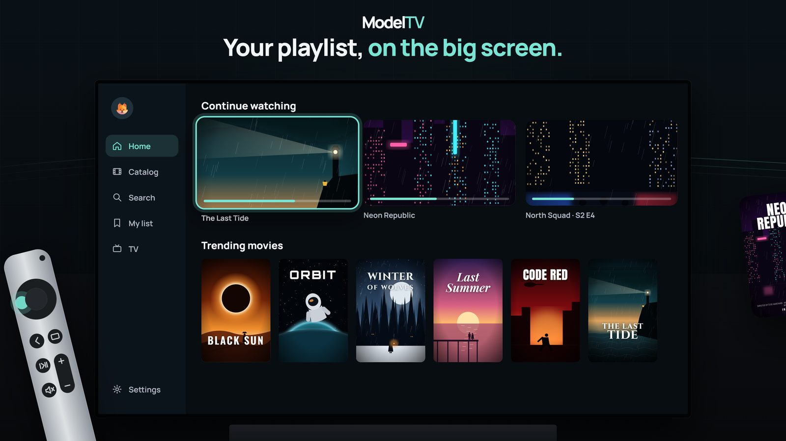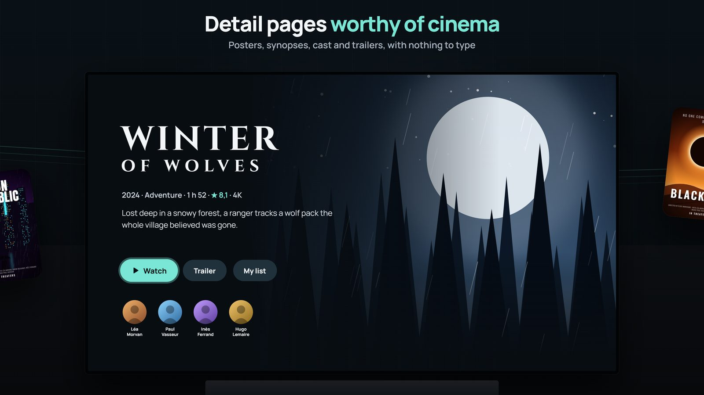</p>

**Movies and series**
- Pages from TMDb: posters, synopsis, rating, cast and trailers
- Continue watching, resume, next episode, skip intro, recap and credits
- Search by title or actor, trending and top 10 rows
- My list and history, for each profile

<p align="center">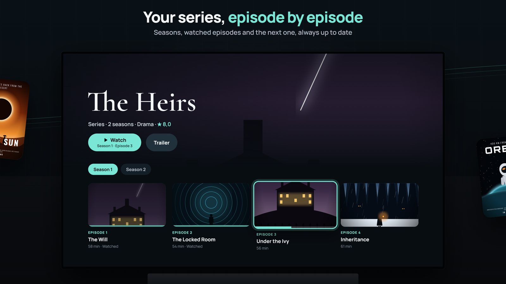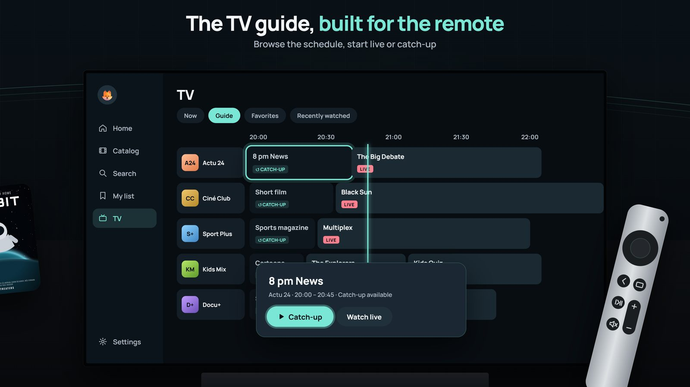</p>

**Live TV**
- TV guide (XMLTV or your provider's), with catch-up when your provider offers it
- One channel for all its sources: 4K, FHD, HD and SD lines grouped, best quality first, the others kept as fallback
- Favourites, personal categories and recent channels; zap with Up/Down or P+/P-

**Your playlists**
- M3U playlists and Xtream logins, typed with the remote or sent from your phone
- Up to 20 playlists in one catalogue: a title offered twice appears once, with all its sources
- Show or hide your provider's categories, for each profile

<p align="center">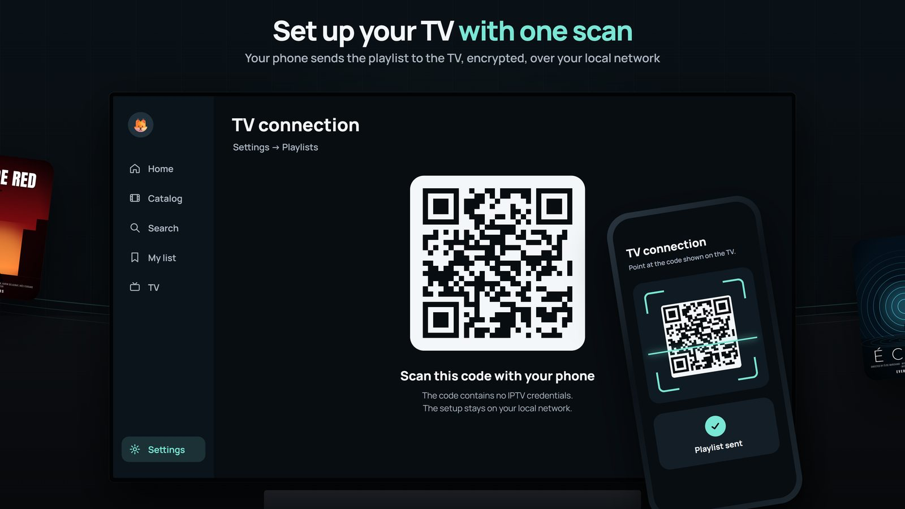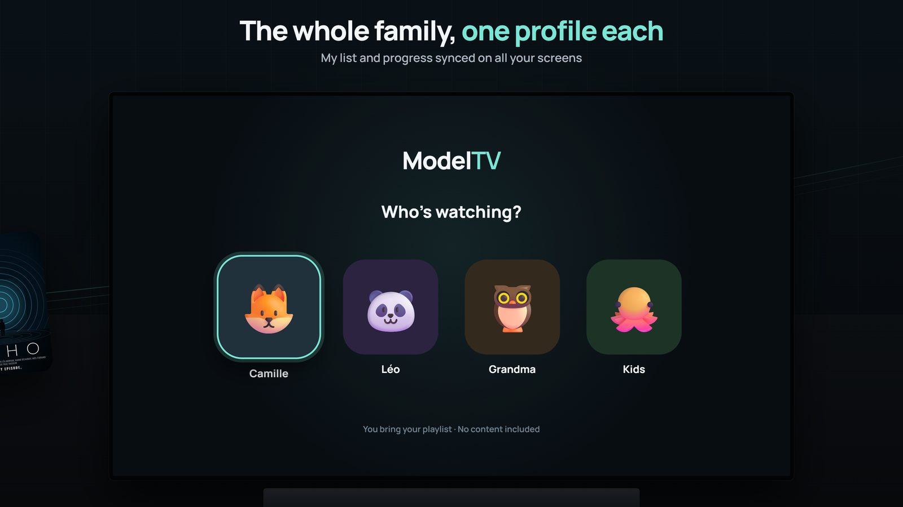</p>

**Every screen, everyone**
- Profiles ("Who's watching?") with their own list, history and settings
- Optional ModelTV account: profiles, My list and resume points follow you from the phone to the TV
- Synced playlists are end-to-end encrypted: no one but your devices, not even ModelTV, can read them
- Set up a TV by scanning a QR code with your phone
- Google Cast, AirPlay and optional Trakt sync

**Make it yours**
- 18 accent colours and 4 themes: Night, OLED black, Slate and Tinted
- English, French, Spanish, German, Italian and Portuguese
- Free for now, no ads, no account required

<p align="center">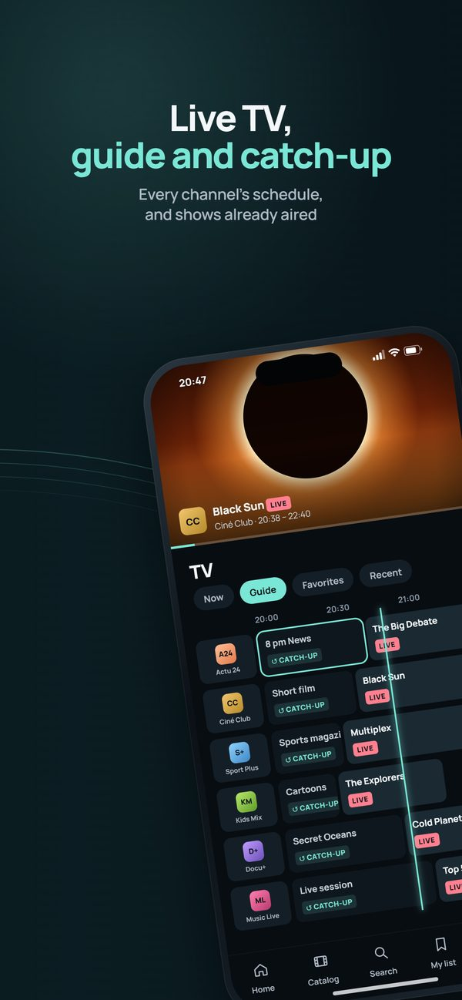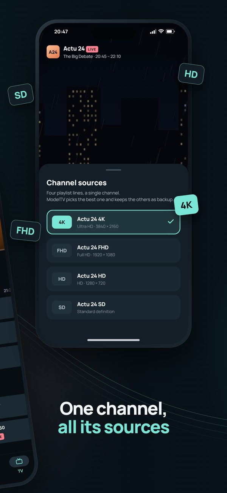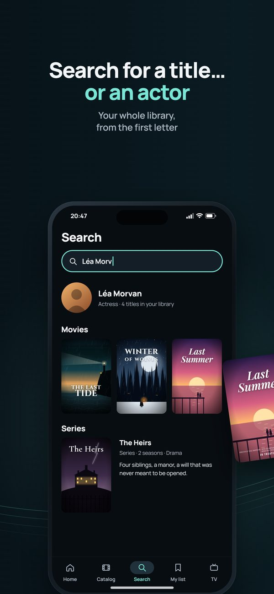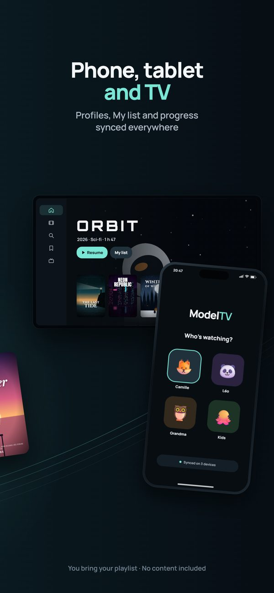</p>

## 📺 Devices

| Device | Requires | Where to get it |
|---|---|---|
| Android phones and tablets | Android 8 or later | Google Play or the APK |
| Android TV and Google TV | Android 8 or later | Google Play or the APK |
| Fire TV | Fire OS 7 or later | The APK, with the Downloader app |
| iPhone and iPad | iOS 15 or later | App Store |
| Apple TV | tvOS 16 or later | App Store, coming soon |

Samsung and LG TVs don't accept Android or Apple apps: plug a Google TV or Fire TV stick, or an Apple TV, into an HDMI port. Fire TV models running Vega OS can't run Android apps.

## 📦 Install the APK

For devices without the Play Store, such as Fire TV:

1. Install the free **Downloader** app from your device's store.
2. Type the code **2040997**, or the address `modeltv.app/apk`.
3. Open the downloaded file and allow the installation.

Step-by-step guides for each device: [modeltv.app/en/tv](https://modeltv.app/en/tv/). The APK version checks for updates on its own and offers them as soon as they are out.

Each release on this page contains `ModelTV.apk` (always the latest version) and the same file under its version name. Every APK is signed with the same certificate, whose SHA-256 fingerprint is:

```
C9:82:A6:46:AD:F2:22:B5:89:63:22:35:7A:BD:A9:56:92:28:00:9D:48:9A:0F:D4:63:24:E4:02:A9:FF:16:D3
```

## 🔒 Privacy

Without an account, your playlists and logins stay on your device. With an account, they are end-to-end encrypted before they leave it.

- [Privacy policy](https://modeltv.app/en/privacy/)
- [Delete your account](https://modeltv.app/en/delete-account/)
- Pages kept for older versions of the app: [confidentialité](https://b-dagbert.github.io/ModelTV-Releases/confidentialite) and [suppression du compte](https://b-dagbert.github.io/ModelTV-Releases/suppression-compte)

## ✉️ Contact

A problem or a question? Write to **contact@modeltv.app**: every message gets a reply.

## 🗂️ About this repository

This repository only hosts ModelTV's public files: the APK releases and their update manifest, the demo playlist, and the pages required by the app stores. The source code is not public.

<a name="francais"></a>

## 🇫🇷 En français

ModelTV est le lecteur IPTV pensé pour la télécommande : vos playlists M3U et accès Xtream deviennent un catalogue digne d'une plateforme de streaming, avec affiches, résumés, guide TV, replay quand votre fournisseur le propose, et un profil pour chacun, du téléphone à la télé. Gratuit pour l'instant, sans publicité, en six langues. ModelTV ne fournit aucun contenu : il lit les sources que vous ajoutez vous-même.

- [Site](https://modeltv.app) et [guide d'installation sur la télé](https://modeltv.app/tv/)
- [Nouveautés](https://modeltv.app/nouveautes/)
- [Google Play](https://play.google.com/store/apps/details?id=app.modeltv.player), [App Store](https://apps.apple.com/app/id6818954576) ou [l'APK](https://github.com/B-DAGBERT/ModelTV-Releases/releases/latest/download/ModelTV.apk) (code Downloader **2040997**)
- [Politique de confidentialité](https://modeltv.app/confidentialite/) et [suppression du compte](https://modeltv.app/suppression-compte/)
- Contact : **contact@modeltv.app**

---

<sub>This product uses the TMDB API but is not endorsed or certified by TMDB. Demo films: Sintel, Tears of Steel and Elephants Dream, © Blender Foundation, under Creative Commons licences. Google Play and the Google Play logo are trademarks of Google LLC. App Store is a service mark of Apple Inc.</sub>
